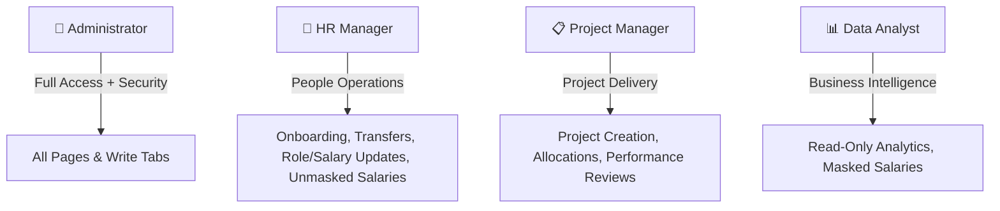
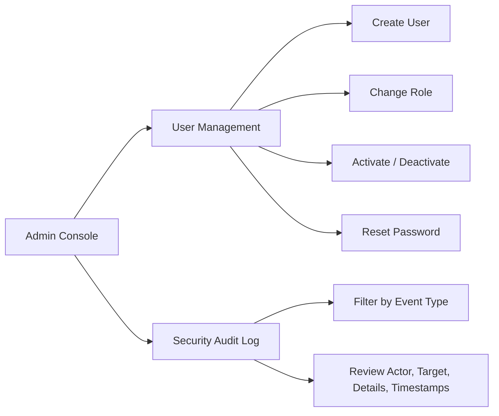

# Role-Based Access Control (RBAC) & Authentication System

## 1. Executive Summary

This document provides a comprehensive technical and functional explanation of the **Role-Based Access Control (RBAC)**, authentication, session management, and data protection system implemented in the **Enterprise Employee Analytics & Data Warehouse** application.

Previously, the application was unauthenticated—any user opening the interface could view executive salaries, onboard new employees, transfer departments, modify compensation, assign projects, or submit performance reviews. 

The new RBAC system implements a **multi-tiered defense-in-depth architecture** enforcing strict access boundaries across **4 distinct roles** and **18 granular permission keys**, coupled with cryptographic password protection, brute-force defense, session timeouts, automated data masking, and full security audit logging.

```
┌─────────────────────────────────────────────────────────────────────────────┐
│                           DEFENSE-IN-DEPTH TIERS                            │
├─────────────────────────────────────────────────────────────────────────────┤
│ 1. Routing Gate (main.py)         ── Only permitted pages appear in sidebar │
│ 2. View Tab Gate (views 1–5)      ── Write tabs completely hidden           │
│ 3. Data Masking (auth.py)         ── "Restricted" replaces salaries         │
│ 4. Service Decorator (auth.py)    ── @requires_permission on write methods  │
│ 5. Audit Logger (auth_manager.py) ── Immutable audit log in MySQL           │
└─────────────────────────────────────────────────────────────────────────────┘
```

---

## 2. Core Security Architecture & Principles

### A. Fail-Closed Security Posture
All access controls default to **DENY**:
- If there is no authenticated user in session, every permission check (`has_permission()` or `@requires_permission`) returns `False` or raises `PermissionDenied`.
- If an account is deactivated in the database while an active session exists, the next rerun immediately clears the session and terminates execution.
- If the database drops connection during user verification, the app treats the session as logged out rather than reusing stale snapshot data.

### B. Concurrency & Session Safety in Streamlit
Streamlit executes each browser tab's script in an independent worker thread within a shared process.
- **No Global Variables**: User authentication snapshots are strictly scoped to `st.session_state["_current_user"]`, preventing privilege leakage between concurrent users.
- **ContextVar for Testing**: A Python `ContextVar` (`_user_context`) is used exclusively for unit tests, CLI scripts, and `override_user()` test harnesses, ensuring complete thread isolation.
- **Per-Rerun DB Rebuild**: On every page interaction, `main.py` fetches a fresh snapshot from MySQL using the primary key `user_id` to immediately reflect any role changes or account lockouts.

---

## 3. The 4 Application Roles

The application defines 4 business roles reflecting corporate access hierarchies:



| Role | Business Function | Permissions Summary | Compensation Access |
| :--- | :--- | :--- | :---: |
| **`admin`** | System administrator & security officer | Full read/write across all modules, user administration, security audit logs | **Full / Unmasked** |
| **`hr_manager`** | People operations & HR business partner | Employee onboarding, department transfers, role & compensation updates, analytics | **Full / Unmasked** |
| **`project_manager`** | Project delivery & resource manager | Create projects, assign employees, submit reviews, view project health & reviews | **Masked (`"Restricted"`)** |
| **`analyst`** | Business intelligence & executive reporting | Read-only access to workforce analytics, project health, review trends | **Masked (`"Restricted"`)** |

---

## 4. Roles × Permissions Matrix (4 Roles × 18 Keys)

The system enforces exactly **18 granular permission keys** declared in [`src/permissions.py`](file:///src/permissions.py):

| Permission Key | Description | `admin` | `hr_manager` | `project_manager` | `analyst` |
| :--- | :--- | :---: | :---: | :---: | :---: |
| `account.password` | Change own account password | **YES** | **YES** | **YES** | **YES** |
| `assignment.create` | Assign employee to a project | **YES** | — | **YES** | — |
| `assignment.view` | View project employee assignments | **YES** | **YES** | **YES** | **YES** |
| `audit.view` | View security audit logs in Admin page | **YES** | — | — | — |
| `dashboard.export` | Download Retention Watchlist CSV | **YES** | **YES** | — | — |
| `dashboard.view` | Access workforce analytics dashboard | **YES** | **YES** | **YES** | **YES** |
| `dashboard.watchlist` | View retention review queue table | **YES** | **YES** | — | — |
| `employee.history.view`| View employee SCD Type 2 history | **YES** | **YES** | **YES** | **YES** |
| `employee.onboard` | Onboard new employee into OLTP & DW | **YES** | **YES** | — | — |
| `employee.search` | Search employee directory | **YES** | **YES** | **YES** | **YES** |
| `employee.transfer` | Transfer employee between departments | **YES** | **YES** | — | — |
| `employee.update_role` | Change employee role, level, or salary | **YES** | **YES** | — | — |
| `project.create` | Create new operational project | **YES** | — | **YES** | — |
| `project.view` | View projects directory and status | **YES** | **YES** | **YES** | **YES** |
| `review.submit` | Submit employee performance evaluation | **YES** | — | **YES** | — |
| `review.view` | View historical performance ratings | **YES** | **YES** | **YES** | **YES** |
| `salary.view` | View unmasked salary & hike metrics | **YES** | **YES** | — | — |
| `user.manage` | User management & password resets | **YES** | — | — | — |

---

## 5. Multi-Layer Defense Implementation

### Layer 1: Navigation & Routing Gate ([`app/main.py`](file:///app/main.py))
When an unauthenticated user visits the app, `main.py` hides the entire application navigation and displays only the login view ([`0_Login.py`](file:///app/views/0_Login.py)).
Once authenticated, the sidebar navigation menu is dynamically constructed containing **only** pages for which the user holds viewing permissions:
- `dashboard.view` $\rightarrow$ `Analytics Dashboard`
- `employee.search` $\rightarrow$ `Employees`
- `project.view` $\rightarrow$ `Projects`
- `review.view` $\rightarrow$ `Reviews`
- `employee.history.view` $\rightarrow$ `Employee changes`
- `user.manage` $\rightarrow$ `Admin`
- Always included $\rightarrow$ `My Account`

### Layer 2: View Tab Gating ([`app/views/`](file:///app/views/))
Views that combine search/view features with write forms use dynamic tabs based on permission checks:
- **`1_Onboard_Employee.py`**:
  - `employee.onboard` present: Shows `["Onboard Employee", "Search Employee"]`.
  - Non-HR (`project_manager`, `analyst`): Only shows `["Search Employee"]`.
- **`2_Projects.py`**:
  - `project.create`: Adds `"Create Project"` tab.
  - `assignment.create`: Adds `"Assign Employee"` tab.
  - Read-only: Shows only `"View Assignments"` and `"Search Assignment"`.
- **`3_Reviews.py`**:
  - `review.submit`: Shows `["Employee Reviews", "Submit Review"]`.
  - Read-only: Only shows `"Employee Reviews"`.
- **`4_Update_Department.py`**:
  - Non-HR roles only see `"Current Departments"`; `"Transfer Department"` and `"Update Role / Salary"` tabs are not rendered.

### Layer 3: Dynamic Data Masking ([`src/auth.py`](file:///src/auth.py))
Compensation privacy is strictly enforced for users lacking `salary.view`:
- The helper `mask_columns(df, columns=["monthly_income", "salary_hike_pct"], mask_value="Restricted")` operates on a **defensive copy** of DataFrames.
- **Cache Boundary Preserved**: Data warehouse queries and managers still fetch and cache numeric data under `@st.cache_data`. Masking is applied **after** the cache retrieval immediately before UI rendering.
- **Gantt Chart Protection**: The SCD2 Timeline Gantt chart visually encodes compensation. It checks `can_show_gantt()`: if the user lacks `salary.view`, the chart is withheld and replaced with an informational callout.
- **Executive Metric Masking**: In the Analytics Dashboard, salary-dependent metrics (e.g. Retention At-Risk count and Watchlist) are masked as `"Restricted"`, and CSV exports are hidden unless granted `dashboard.export`.

### Layer 4: Service Layer Method Decorators ([`src/managers/`](file:///src/managers/))
Even if an attacker bypassed the UI or injected form calls, the underlying managers refuse execution. Six core write methods are wrapped with the `@requires_permission` decorator:
1. `EmployeeManager.create` $\rightarrow$ requires `employee.onboard`
2. `EmployeeManager.update_department` $\rightarrow$ requires `employee.transfer`
3. `EmployeeManager.change_role_or_salary` $\rightarrow$ requires `employee.update_role`
4. `ProjectManager.create` $\rightarrow$ requires `project.create`
5. `ProjectManager.assign_employee` $\rightarrow$ requires `assignment.create`
6. `ReviewManager.create` $\rightarrow$ requires `review.submit`

If invoked without permission, `@requires_permission`:
1. Immediately raises `PermissionDenied(f"Permission '{perm_key}' required")`.
2. Emits an `access_denied` security audit log to MySQL recording the offending user ID, attempted action, and timestamp.
3. Views catch `PermissionDenied` and display a red `st.error()` notification.

---

## 6. Authentication & Cryptographic Defenses

### A. Bcrypt Password Hashing
- Passwords are encrypted using `bcrypt` with a salt work factor of **12 rounds**.
- Plaintext passwords are never persisted to disk, session state, or audit logs.
- Validation requires at least 12 characters, uppercase, lowercase, digit, and prohibits using the username as the password.

### B. Timing Equalization (Side-Channel Defense)
- Attackers often identify whether an account exists by measuring response time (a non-existent user returns faster than a real user whose password must be hashed with bcrypt).
- When a user enters an unknown username, [`src/managers/auth_manager.py`](file:///src/managers/auth_manager.py) computes a dummy bcrypt verification against a pre-computed constant `DUMMY_HASH`, equalizing response duration to $\approx 300\text{ ms}$.
- A single generic error message (`AUTH_ERROR_MESSAGE = "Invalid username or password."`) is returned across all failure scenarios (unknown account, wrong password, inactive account, or locked account).

### C. Brute-Force Defense & Automated Lockouts
- `failed_attempts` is incremented on every invalid login.
- Upon the **5th consecutive failure**, the account is locked for **15 minutes**.
- Lockout expiration is evaluated against the authoritative **database clock** (`DATE_ADD(NOW(), INTERVAL 15 MINUTE)`), preventing client-side clock tampering.
- Successful authentication resets `failed_attempts` to 0.

### D. Session Lifecycles & Timeouts
1. **Idle Timeout (30 minutes)**: If no user action occurs for 30 minutes, the session expires, logging `session_expired` (reason: `idle_timeout`).
2. **Absolute Timeout (8 hours)**: Regardless of activity, sessions expire after 8 hours to prevent zombie logins.
3. **Mandatory First-Time Password Reset (`must_change_password`)**: Newly provisioned users or reset accounts have `must_change_password = 1`. Until updated on the Account page, all navigation pages remain locked out.
4. **Seamless Logout**: The logout handler invalidates the session and redirects to Login with a smooth 3-second auto-vanishing notification banner.

---

## 7. Administrative Security & Operator Guardrails

The Administration view ([`app/views/6_Admin.py`](file:///app/views/6_Admin.py)) provides centralized user governance protected by `user.manage`:



### Safety Guardrails Built into `AuthManager`:
- **No Self-Demotion**: An administrator cannot demote their own account to another role.
- **No Self-Deactivation**: An administrator cannot deactivate their own account.
- **Last Active Admin Protection**: The system prevents demoting or deactivating the last active administrator, ensuring the organization is never permanently locked out of management access.

---

## 8. Database Architecture (`sql/09_auth_ddl.sql`)

### `app_users` Table
Stores authentication credentials, state, and role assignments:
```sql
CREATE TABLE IF NOT EXISTS app_users (
    user_id              INT AUTO_INCREMENT PRIMARY KEY,
    username             VARCHAR(100) NOT NULL UNIQUE,
    password_hash        VARCHAR(255) NOT NULL,
    role                 ENUM('admin','hr_manager','project_manager','analyst') NOT NULL,
    is_active            TINYINT(1) NOT NULL DEFAULT 1,
    must_change_password TINYINT(1) NOT NULL DEFAULT 1,
    failed_attempts      INT NOT NULL DEFAULT 0,
    locked_until         DATETIME NULL,
    password_changed_at  DATETIME NULL,
    created_at           DATETIME NOT NULL DEFAULT CURRENT_TIMESTAMP,
    last_login           DATETIME NULL,
    created_by           INT NULL,
    CONSTRAINT fk_user_creator FOREIGN KEY (created_by)
        REFERENCES app_users(user_id) ON DELETE SET NULL
) ENGINE=InnoDB;
```

### `app_audit_log` Table
Stores immutable forensic records of all authentication and authorization events:
```sql
CREATE TABLE IF NOT EXISTS app_audit_log (
    audit_id           BIGINT AUTO_INCREMENT PRIMARY KEY,
    event_type         VARCHAR(40) NOT NULL,
    actor_user_id      INT NULL,
    target_user_id     INT NULL,
    username_attempted VARCHAR(100) NULL,
    details            JSON NULL,
    created_at         DATETIME NOT NULL DEFAULT CURRENT_TIMESTAMP,
    INDEX idx_audit_created (created_at),
    INDEX idx_audit_actor (actor_user_id),
    INDEX idx_audit_event (event_type)
) ENGINE=InnoDB;
```

### Automatic Default Admin Seed
`sql/09_auth_ddl.sql` includes an idempotent bootstrap insert with the pre-computed bcrypt hash of `AdminPass1234!`:
```sql
INSERT INTO app_users (username, password_hash, role, is_active, must_change_password)
VALUES ('admin', '$2b$12$yb/9LOt8LmDj2oiz3ZVAL.dnJRUz02QlpmyoXEk49fWMztT7i6Ge6', 'admin', 1, 1)
ON DUPLICATE KEY UPDATE username = username;
```

---

## 9. Automated Testing Suite

The implementation is verified by an automated test suite containing **99 tests**:

- **Unit & Security Tests**:
  - `tests/test_permissions.py`: 18 keys count, role permission mappings, permission inheritance.
  - `tests/test_auth_manager.py`: Bcrypt verification, timing equalization, brute-force lockout, fail-closed access, audit logging, admin safety guardrails.
  - `tests/test_main_auth_gate.py`: Idle/absolute timeouts, fail-closed handling on DB failure or inactive accounts.
- **View Testing (`streamlit.testing.v1.AppTest`)**:
  - `tests/test_phase4_phase5.py`: Exercises real Streamlit views (`0_Login`, `1_Onboard`, `2_Projects`, `3_Reviews`, `4_Update_Department`, `5_Analytics`, `6_Admin`, `7_Account`) verifying tab visibility, CSV download button suppression, Gantt chart notices, and role-based data rendering.

```bash
# Run the test suite:
pytest tests/ -v
# 99 passed in ~11.6s
```

---

## 10. Summary of Files Created & Modified

| File | Purpose |
| :--- | :--- |
| [`sql/09_auth_ddl.sql`](file:///sql/09_auth_ddl.sql) | DDL migration for `app_users`, `app_audit_log`, and default `admin` seed |
| [`src/permissions.py`](file:///src/permissions.py) | 18 permission keys, 4 roles, and `ROLE_PERMISSIONS` matrix definition |
| [`src/auth.py`](file:///src/auth.py) | Password complexity, bcrypt hashing, `@requires_permission`, and `mask_columns()` |
| [`src/managers/auth_manager.py`](file:///src/managers/auth_manager.py) | Authentication logic, brute-force locking, user CRUD, audit logger, admin safety guards |
| [`scripts/create_admin.py`](file:///scripts/create_admin.py) | CLI bootstrap tool and emergency operator password reset script |
| [`app/main.py`](file:///app/main.py) | Top-of-run auth gate, idle/absolute timeouts, dynamic menu filtering, logout |
| [`app/views/0_Login.py`](file:///app/views/0_Login.py) | Responsive centered login card with auto-vanishing logout feedback |
| [`app/views/6_Admin.py`](file:///app/views/6_Admin.py) | User management portal and audit log table (requires `user.manage`) |
| [`app/views/7_Account.py`](file:///app/views/7_Account.py) | Self-service password change and first-time forced password change gate |
| [`app/views/1_Onboard_Employee.py`](file:///app/views/1_Onboard_Employee.py) | Tab-level gating for onboarding; search view |
| [`app/views/2_Projects.py`](file:///app/views/2_Projects.py) | Tab-level gating for project creation and employee allocations |
| [`app/views/3_Reviews.py`](file:///app/views/3_Reviews.py) | Tab-level gating for performance review submissions |
| [`app/views/4_Update_Department.py`](file:///app/views/4_Update_Department.py) | Tab-level gating for department transfers and compensation updates |
| [`app/views/5_Analytics_Dashboard.py`](file:///app/views/5_Analytics_Dashboard.py) | Post-cache salary masking, Gantt chart permissions callout, watchlist & CSV gating |
